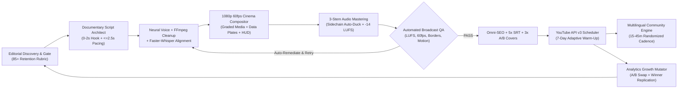

# VELUM — Autonomous Visual Documentary & Broadcast Engine

[](https://github.com/MFTTT11/velum-studio/actions/workflows/autopilot.yml)


**Visual Comparisons • Hidden Systems • Extreme Reality**  
**VELUM** (`@VelumArchive`) is an end-to-end autonomous media engineering pipeline that researches, scripts, voices, animates, masters, verifies, publishes, and iteratively optimizes high-retention visual documentaries for YouTube—combining cinema-grade color grading, procedural sound design, live telemetry HUDs, and closed-loop analytics optimization.

---

## System Architecture



---

## Engineering Highlights

### 1. Broadcast-Grade Visual & Audio Pipeline (`/engine/`)
- **0–2.0s Opening Hook:** Frame-zero high-contrast typographic impact card synchronized with custom-synthesized sub-bass impact and stereo sweep SFX.
- **Strict 2.5-Second Pacing:** Spoken narration is word-aligned via `faster-whisper` after FFmpeg `silenceremove`, automatically subdividing scenes so no shot stays static beyond `2.5s`.
- **Alternating Visual Grammar:** Pairs teal-obsidian graded high-resolution photography with five animated editorial data plates (`comparison_bars`, `metric_hero`, `system_nodes`, `timeline_scale`, `radar_alert`) rendered with ease-out cubic kinematics.
- **Live Telemetry HUD:** Real-time progress rail, chapter tags, live metric counters, timecode, and `@VelumArchive` watermark composited at native 60fps (`1080x1920` vertical & `1920x1080` widescreen).
- **Kinetic Word-Level Captions:** LibASS subtitle engine scales and highlights each spoken word and numeric callout frame-accurately in the safe viewing zone.
- **3-Stem Cinema Audio Mastering:** Procedural stereo SFX and dark minor underscore ducked dynamically beneath speech via FFmpeg `sidechaincompress` and loudness-normalized to broadcast `-14 LUFS`.
- **Automated Quality Gate (`engine/qa_gate.py`):** Independently validates resolution, frame rate (`>= 59fps`), format duration caps, integrated LUFS & True Peak (`ebur128`), borderless framing (`cropdetect`), and motion continuity (`freezedetect`). Any failed render automatically recalibrates loudness or speech cadence and re-renders.

### 2. Multi-Surface Discovery & Closed-Loop Growth (`/publisher/`)
- **Omni-SEO (`publisher/omni_seo.py`):**
  - **VSEO:** Confirms the primary target keyword is spoken inside the opening 15 seconds of the Whisper transcript.
  - **SEO:** Exports canonical `keyword-slug.mp4` filenames, 3 A/B/C titles, 300+ word structured editorial descriptions, timeline chapters, and targeted tags.
  - **GEO & AEO:** Appends machine-citable Key Data Summaries, 3-question FAQs, debate-focused Pinned First Comments, and multi-language `.srt` caption tracks (`en`, `tr`, `es`, `de`, `fr`).
- **Adaptive Warm-Up Scheduler (`publisher/youtube_uploader.py`):** Enforces a progressive 7-day cadence (`publishAt`) that scales organically from 1 Short/day on Days 1–2 (switching extra CI runs automatically into *Engagement-Only Mode*) to 2–3 Shorts/day plus widescreen documentaries every 2 days.
- **Multilingual Community Responder (`publisher/comment_responder.py`):** Filters links/bots/spam, detects viewer language natively, queues contextual replies with randomized 15–45 minute delays, and deduplicates via SHA-256 hashes in `state.db`.
- **Autonomous Growth Mutator (`publisher/growth_mutator.py`):** Evaluates YouTube Analytics retention and CTR; automatically regenerates and swaps A/B Variant #2/#3 titles and thumbnails when thresholds dip (`< 70%` Shorts retention or `< 5%` widescreen CTR) and prioritizes top-performing content pillars on subsequent cycles.

### 3. Zero-Leak Public Repository Security Model
Architected for safe execution on public GitHub Actions infrastructure:
- **`.gitignore` Guardrails:** Permanently excludes `client_secrets.json`, `token.json`, `.env`, `*.key`, `*.pem`, `secrets/`, `output/`, and `*.mp4`.
- **Ephemeral Credential Lifecycle:** OAuth secrets are read solely from environment variables / GitHub Secrets, materialized only during active API calls, and zero-overwritten & unlinked immediately on completion (`core/config.py`) plus purged unconditionally in CI `if: always()`.
- **Redacted Telemetry & Clean State:** Every logger scrubs keys, tokens, and emails before stdout. `state.db` stores exclusively anonymized operational state and repository-relative paths—never PII, credentials, or local machine paths.

---

## Local Quick Start

### Requirements
- Python `3.12+`
- `ffmpeg` and `ffprobe` available on `PATH`

### Installation & Execution
```bash
pip install -r requirements.txt
python autopilot.py
```

### CLI Options
```bash
# Single autonomous production & growth cycle (CI entrypoint)
python autopilot.py --run-once

# Render a 16:9 widescreen documentary in dry-run mode
python autopilot.py --format longform --dry-run

# Override daily warm-up cap for an immediate production run
python autopilot.py --force-produce

# Continuous local scheduler (runs every 8 hours)
python autopilot.py --daemon
```

---

## Cloud Automation (GitHub Actions)

[`.github/workflows/autopilot.yml`](.github/workflows/autopilot.yml) runs automatically **3 times daily** (`06:00`, `14:00`, `22:00 UTC`), executes full production or engagement-only cycles based on the warm-up schedule, wipes all temporary credentials and media in an `if: always()` block, and commits only the sanitized `state.db` back to `main`.

### 1. Generate YouTube OAuth Secrets Locally
1. Enable **YouTube Data API v3** and **YouTube Analytics API** in Google Cloud Console.
2. Create an **OAuth 2.0 Desktop Client ID** and save it temporarily as `./client_secrets.json` (gitignored).
3. Run the local-only authorization utility:
   ```bash
   python tools/auth_helper.py
   ```
   Complete browser consent, copy the Base64 strings for `YOUTUBE_CLIENT_SECRETS` and `YOUTUBE_TOKEN`, and confirm secure deletion of the local JSON files.

### 2. Configure Repository Secrets
Go to **Settings → Secrets and variables → Actions → New repository secret**:

| Secret | Required | Purpose |
|---|---|---|
| `YOUTUBE_CLIENT_SECRETS` | Live publishing | Raw or Base64 Google Cloud OAuth Desktop JSON |
| `YOUTUBE_TOKEN` | Live publishing | Raw or Base64 OAuth refresh token JSON from `tools/auth_helper.py` |
| `GEMINI_API_KEY` | Optional | Dynamic LLM ideation, scripting, and multilingual enrichment |
| `GROQ_API_KEY` | Optional | High-speed Llama 3.3 70B LLM provider |
| `OPENROUTER_API_KEY` | Optional | Multi-model LLM routing fallback |
| `PEXELS_API_KEY` | Optional | Additional HD editorial photography source |
| `PIXABAY_API_KEY` | Optional | Additional HD editorial photography source |

### 3. Run a Cloud Verification Build
Open **Actions → VELUM — Autonomous Broadcast Autopilot → Run workflow** with `dry_run: true` to execute a full cloud render and QA validation without modifying `state.db` or publishing live.

---

## Project Structure

```text
├── .github/workflows/autopilot.yml   # Automated 3x/day cloud broadcast workflow
├── .env.example                      # Clean environment variable reference template
├── .gitignore                        # Credential and media exclusion lock
├── autopilot.py                      # Main pipeline orchestrator and CLI
├── requirements.txt                  # Python runtime dependencies
├── state.db                          # Sanitized SQLite operational state
├── brand_kit/                        # VELUM identity config and high-res PNG assets
├── prompts/                          # Editorial scoring, scripting, SEO & reply rubrics
├── core/                             # Security config, secret redaction, StateDB, LLM router
├── engine/                           # Discovery, scripting, voice, SFX, HUD, 60fps render, QA
├── publisher/                        # Omni-SEO, warm-up uploader, comment bot, growth mutator
└── tools/auth_helper.py              # Local OAuth Base64 helper for GitHub Secrets
```
